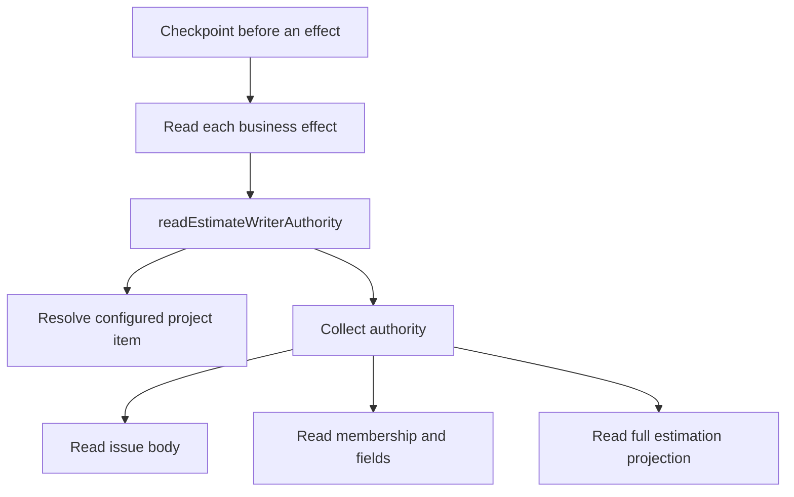

# #2039 authority query attribution

A completed native Refine entry for issue #2060 generated 507 captured CLI observations, 336 known points and 171 unknown-cost observations. Three repeated query shapes account for 324 known points (96.4% of the measured subtotal). Complete HTTP traffic and account-wide consumption remain unmeasured.

## Measured interval

Start 2026-10-20T10:02:32.739Z; end 2026-10-20T10:12:10.185Z; duration 577 seconds; exit 0. Retained native collector records were filtered by worktree and the completed controller-command interval. This analysis made no GitHub requests. The subsequent R4P invocation measured 65 observations, 30 known points and 35 unknown costs.

| Query or invocation | Observations | Known points | Unknown-cost observations |
| --- | ---: | ---: | ---: |
| Full `AitmEstimationProjection` | 120 | 120 | 0 |
| Configured membership with field values | 120 | 120 | 0 |
| Configured membership without field values | 84 | 84 | 0 |
| Opaque `gh issue view` | 148 | 0 | 148 |
| Opaque `gh issue edit` | 11 | 0 | 11 |
| Other captured invocations | 24 | 12 | 12 |
| Total | 507 | 336 | 171 |

Zero known points for an opaque command means no reported cost was available. CLI invocations may hide multiple HTTP requests and retries.

## Exact source matches

The membership query constructor is `scripts/gh/lib/project-membership.mjs:20`. An injected `runGql` callback captured its first query and deliberately stopped before transport. Both the original and normal cost-augmented query were passed through the native identity parser. No network, business effect, proof marker or source modification occurred.

`scripts/gh/lib/github-projects.mjs:60` inserts `_aitmUsage: rateLimit { cost }` before invoking gh. The CLI collector identifies the already-augmented document in `scripts/task-tracker/lib/graphql-usage/collection.mjs:328`. Consequently its fingerprint differs from the raw source template. The same augmentation applied offline produced exact observed matches:

```json
[
  {
    "label": "configured-membership",
    "original": {
      "kind": "query",
      "operation": null,
      "queryFingerprint": "sha256:1f7cc4181d94045e64b26e014cdac111512bfd0823dc56a49c9685d3642691ee",
      "fingerprintVersion": "v1"
    },
    "observedShape": {
      "kind": "query",
      "operation": null,
      "queryFingerprint": "sha256:2e9aad4db59390fe2f25c72aaa36d8e8e6ed8581fe8d2b70d99485749761286f",
      "fingerprintVersion": "v1"
    },
    "alias": "_aitmUsage"
  },
  {
    "label": "configured-membership-with-fields",
    "original": {
      "kind": "query",
      "operation": null,
      "queryFingerprint": "sha256:eedaf4ce2816b269de5092ffd1077261918578dbbee3c6b7e845eb7040e079e7",
      "fingerprintVersion": "v1"
    },
    "observedShape": {
      "kind": "query",
      "operation": null,
      "queryFingerprint": "sha256:eb74807a6a65f2b6bd97223fe7b3dde004d1f6b6c2b5baa8d00570dc8acd446a",
      "fingerprintVersion": "v1"
    },
    "alias": "_aitmUsage"
  }
]
```

The field-bearing query is used by `decomposition-authority.mjs:183` for project authority. The bare constructor is used by `github-projects.mjs:85` (`projectItemForIssue`), including `estimate-writer-publication.mjs:524` subject resolution. These shared constructors can have other callers; exact runtime call stacks are not retained.

The full projection is defined in `scripts/task-tracker/lib/estimation/runtime-adapter.mjs:154` and selected by `decomposition-authority.mjs:213` forecast reads. It returns the full body, up to 100 comments and project fields.

## Source-supported amplification path

Separate Estimate, Size and body-field readers in `decomposition-field-writer.mjs:43–86` each call `readEstimateWriterAuthority`, including for a single scalar. That helper resolves the subject and collects complete authority. `estimate-writer-publication.mjs:454–466` loops business readers at each checkpoint; `decomposition-publication.mjs:116–118` invokes the checkpoint before each adapter.



The diagram shows one source-supported path. It is not an exhaustive runtime trace or a measured function-invocation count. The 120/120/84 counts are observed query invocations.

## Other hotspots and limits

The [usage report](graphql-usage-2026-10-20.md) retains a bounded actual hook sample costing 27 points for a leaf with zero children, and parent inventory reads costing 22 points each. Recognized scoped mutations invoke hook admission in `activity-guard.mjs:191`; its snapshot query includes the nested child graph before kind-specific filtering. Ordinary READ_* activity is outside that recognized-mutation branch.

Response headers separately established actual GraphQL primary exhaustion while the REST overview disagreed. Both endpoints agreed after reset. GitHub internal counter behavior and unobserved clients remain unknown.

Future governed implementation should test scoped read reuse within legitimate freshness boundaries, narrow scalar/marker reads and avoid fetching a child graph for a confirmed leaf. Preserve ownership, mutation fences, proof capabilities, drift detection and verified read-back. No optimization, implementation test or approval is claimed here.
